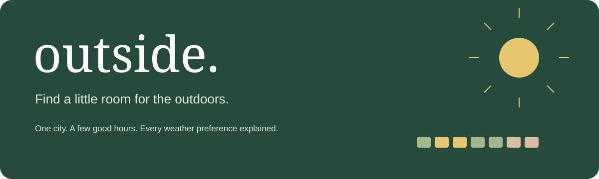
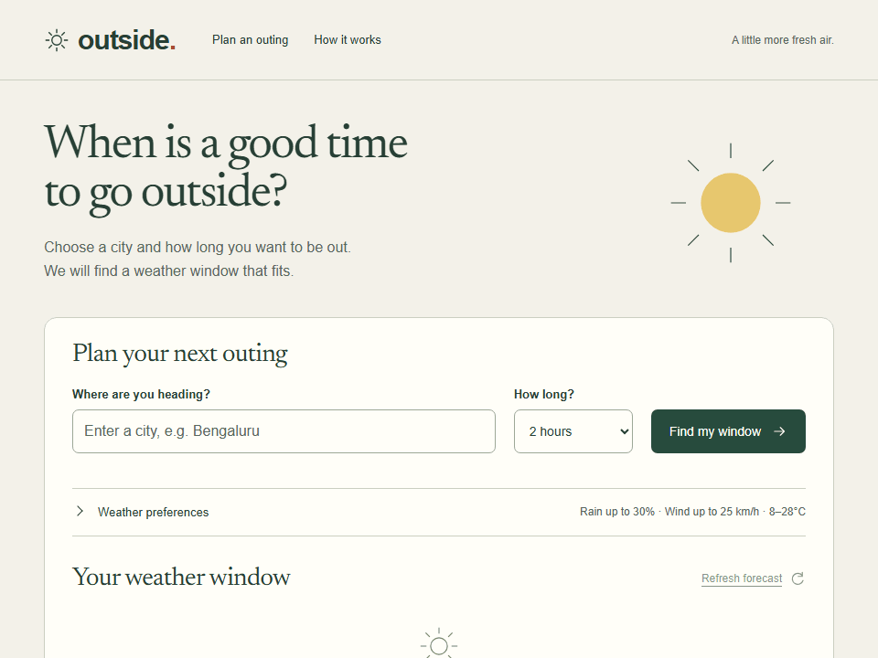
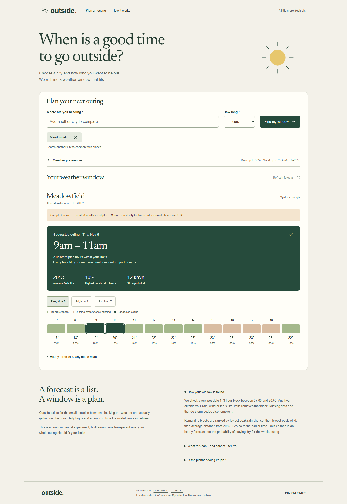
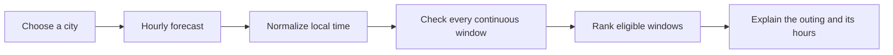

<div align="center">
  
  <p><strong>A continuous weather window for your next walk or casual ride.</strong></p>
  <p>
    <a href="https://brej-29.github.io/outside-weather/"></a>
    <a href="https://github.com/brej-29/outside-weather/actions/workflows/verify-deploy.yml"></a>
    
    
  </p>
  <p><a href="#see-it-in-action">Demo</a> · <a href="#run-locally">Quick start</a> · <a href="#secrets-and-variables">Configuration</a> · <a href="weather_project/docs/WHY.md">Why this exists</a></p>
</div>

## From a forecast to a plan

A dry noon does not tell you whether the next two hours fit your preferences. Outside checks **every hour of your outing**, rejects blocks that do not fit, and suggests a date and time you can inspect.

1. Enter a city and choose **1, 2 or 3 hours**.
2. Click **Find my window**, then choose the correct place.
3. Read your suggested outing. Pick another day or open **Weather preferences** to adjust the limits.

Add a second city to compare places. Times are local to each place. No account or location permission is needed.

## See it in action

<div align="center">
  
  <p><em>Actual interface recording with explicitly invented sample weather and a fictional place. Live mode uses Open-Meteo.</em></p>
</div>

| Your decision | What the planner shows |
| --- | --- |
| When can I go? | A date, start/end time and continuous duration |
| Will each hour fit? | Checks against rain, wind and feels-like limits |
| What about another day? | Day switching recalculates that day's suggestion |
| Why this time? | Hourly values, missing-data labels and rejection reasons |
| What if the service fails? | Bounded requests, caching and a recoverable error state |

<details>
<summary><strong>Phone, tablet and desktop screenshots</strong></summary>

[Phone](weather_project/docs/screenshots/phone.png) · [Tablet](weather_project/docs/screenshots/tablet.png) · [Desktop](weather_project/docs/screenshots/desktop.png)


</details>

## Run locally

Requires **Node.js 22+**. No API key, database or `.env` file is needed.

```sh
git clone https://github.com/brej-29/outside-weather.git
cd outside-weather/weather_project
npm ci
npm run dev
```

Open **http://127.0.0.1:4173**. On PowerShell with script restrictions use `npm.cmd`.

```sh
npm test                         # Core planner tests
npm run evaluate                 # Reproduce 3,000 deterministic cases
npx playwright install chromium  # Install the test browser once
npm run test:e2e                  # Main flow, error states and accessibility
npm run build                    # Static files in dist/
```

## Secrets and variables

**This version requires zero secrets and zero GitHub variables.** Open-Meteo's public noncommercial API needs no key. Pages deployment uses the workflow's built-in permissions, so no personal access token is needed.

| Setting | Where it belongs |
| --- | --- |
| Weather/geocoding URLs, cache duration, timeout and forecast horizon | [`weather_project/web/config.js`](weather_project/web/config.js), public configuration |
| A future CI credential | Repository **Settings → Secrets and variables → Actions → Secrets → New repository secret** |
| A future non-sensitive workflow setting | Same page, **Variables → New repository variable** |
| A future private API key used at runtime | Your server host's environment/secrets settings; this deployment has no server |

[Secrets settings](https://github.com/brej-29/outside-weather/settings/secrets/actions) · [Variables settings](https://github.com/brej-29/outside-weather/settings/variables/actions) · [Official instructions](https://docs.github.com/en/actions/how-tos/write-workflows/choose-what-workflows-do/use-secrets)

Workflow secrets use `${{ secrets.NAME }}`; variables use `${{ vars.NAME }}`. They are available to workflow steps only when wired into those steps. **Anything copied into built HTML or JavaScript becomes public**, even if it started as a GitHub secret. A private weather API would need a server-side proxy.

The retained Django prototype is not deployed. If you intentionally run it, its `DJANGO_SECRET_KEY` belongs in that server's environment. The old local `API_KEY`, database, virtual environment, backup and caches are excluded from this repository.

## Free deployment

**Live:** https://brej-29.github.io/outside-weather/

The root [workflow](.github/workflows/verify-deploy.yml) verifies pull requests and publishes `weather_project/dist/` only from `main`. It then smoke-tests the production files and runs browser tests against the actual repository URL. Settings → Pages is configured to use **GitHub Actions**.

- GitHub Pages supports public repositories on GitHub Free. Published sites may be up to 1 GB, with a soft bandwidth limit of 100 GB/month. [Hosting limits](https://docs.github.com/en/pages/getting-started-with-github-pages/github-pages-limits).
- Open-Meteo's free API is **noncommercial only**, below 10,000 calls/day, 5,000/hour and 600/minute, without an uptime guarantee. [Data terms](https://open-meteo.com/en/terms).
- Forecasts cache locally for 20 minutes; requests time out after 12 seconds and recommendations expire after an hour. Local caching is not global quota enforcement.

To verify a deployment, set `LIVE_URL` in your shell, then run `npm run smoke` and `npm run test:e2e` from `weather_project/`.

## Evidence and honest limits

The threshold was recorded before building: **zero invalid recommendations and exact agreement with an independent exhaustive reference**.

| Synthetic scheduling evaluation | Result |
| --- | --- |
| Complete rankings matching the reference | **3,000 / 3,000** |
| Constraint violations | **0** |
| Cases containing an eligible window | 1,735 |
| First-daytime baseline: valid / optimal starts | 109 / 56 |
| Noon baseline: valid / optimal starts | 95 / 41 |
| First-hour-only ablation: valid / optimal starts | 1,284 / 1,284 |

These deliberately difficult synthetic cases measure software correctness, **not** forecast accuracy, typical weather frequencies, demand or faster decision-making. [Results](weather_project/docs/evaluation.json) · [Validation](weather_project/docs/VALIDATION.md) · [15 skeptical questions and falsification plan](weather_project/docs/WHY.md).

Automated accessibility checks cover phone, tablet and desktop widths. Local Lighthouse measurements are in [the report](weather_project/docs/lighthouse.json); they are not a production SLA or a substitute for assistive-technology testing.

## How it works



Every block between **7am and 8pm local time** is checked across three calendar days. Missing required values and thunderstorm codes reject a block. Eligible windows rank by peak hourly rain chance, then peak wind, then temperature comfort, then earliest start. The first selection opens the best available day; choosing another day updates its suggestion.

There is no model, backend, tracking or automatic geolocation. Queries go to Open-Meteo; preferences and cached forecasts stay in your browser. [Architecture](weather_project/docs/ARCHITECTURE.md) · [Design system](weather_project/DESIGN.md).

This is for ordinary urban outings. Civil hours are not guaranteed daylight. Gusts, air quality, UV, ice, terrain and official warnings are outside scope. Peak hourly rain chance is not the probability of staying dry for the whole outing. Check local warnings before leaving.

Weather: [Open-Meteo](https://open-meteo.com/), [CC BY 4.0](https://creativecommons.org/licenses/by/4.0/). Location data: GeoNames via Open-Meteo. Self-hosted Newsreader uses its included [SIL Open Font License](weather_project/web/fonts/OFL.txt).
